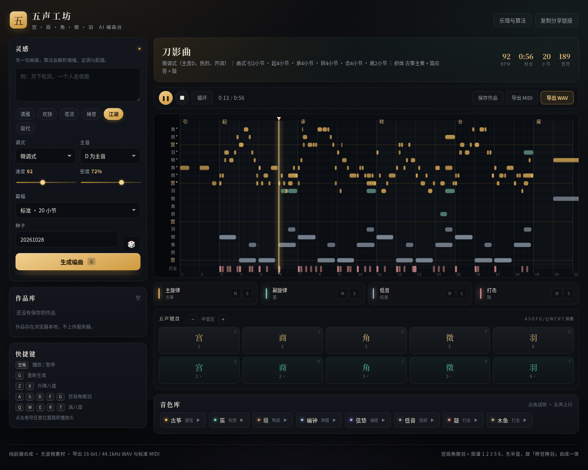

# 五声工坊 · 宫商角徵羽 AI 编曲台

用 **宫 · 商 · 角 · 徵 · 羽** 五声音阶做音乐：写一句灵感，大模型挑音色，本地算法编曲，浏览器里直接弹，一键导出 WAV / MIDI。
没有音频素材文件——17 种音色全部逐采样算出来。

**在线体验**：<https://www.lukezystudio.cn/music/>



## 两层「AI」

**语言层（可选，服务端）**：把「雨夜独处，二胡为主，加点雨声，别太吵」发给大模型，返回结构化的编曲参数——调式、主音、速度、密度、小节数、音轨配器。输出经过严格校验（角色/乐器白名单、主旋律唯一、范围钳制），按 IP 限流、同 prompt 命中缓存，任何失败都自动回退到本地规则。

**编曲层（本地，纯前端）**：

```
动机生成（五声格内受约束游走 + 拱形/上行/波浪轮廓）
  → 曲式发展（引-起-承-转-合-展-收-尾，二句模进、三句对比、四句合尾）
  → 配器（主奏 + 应答 + 铺底 + 低音进行 + 打击 + 氛围）
  → 人声化（时值/力度高斯微扰、长音颤音、倚音）
```

同一 `seed` 永远得到同一首曲子，所以分享链接能完整还原，参数也能随时改了重排。

## 功能

- **33 种音色**：按传统「八音」组织 —— 丝（筝琴琵琶柳琴月琴三弦阮箜篌扬琴、二胡京胡板胡）、竹匏土（笛箫埙笙唢呐管子葫芦丝巴乌陶笛）、金石（编钟编磬锣碰铃）、革木（鼓排鼓木鱼梆子）、电子与氛围
- **9 种曲风**：清雅、欢快、苍凉、禅意、江湖、现代、宫廷、田园、北歌，各有一套 4–6 轨编制
- **11 个可调维度**：调式、主音、织体、和声、曲式、句法、速度、密度、长度、装饰、力度、空间、速度走向，每项在界面里都有说明
- **音轨台**：主旋律/副旋律/铺底/低音/打击/氛围六种角色，可加轨、删轨、换乐器、调音量、静音独奏
- **参数延迟生效**：速度、密度、长度（8–48 小节）、调式、主音、种子改动后不立即重排，点「生成编曲」才生效（避免拖动滑块时反复重算）；换乐器、增删轨道这类明确操作才即时重排
- **五声键盘**：`A S D F G` / `Q W E R T` 演奏，`Z X` 换八度
- **钢琴卷帘**：五声音级为行、小节为列，段落色带、播放头、悬停查阶名、点击跳转
- **导出**：44.1kHz·16bit 立体声 WAV（含卷积混响，按当前静音/独奏混音），标准 SMF format 1 MIDI（每轨独立、含 GM 音色）
- **循环曲式**：一键生成首尾相接的背景乐，导出即无缝循环
- **作品库**：本地保存、分享链接还原

## 循环曲式

打开「循环曲式」后：

- **曲式**：去掉引子与尾声，只剩 起-承-转-合 这类闭环段落；
- **收尾**：末小节的低音落到「回旋音」——纯五度存在时落属音（宫/商/徵/羽调式），否则回主音（角调式）；旋律提前 1.5 拍收尾，留一口气给开头；
- **音频**：渲染时多算 4 秒尾巴，再把尾巴**折回开头**（相当于环形卷积），所以循环点没有断口；
- **播放**：`AudioBufferSourceNode.loop = true`，sample 级无缝，不是「播完再重播」；
- **导出**：WAV 长度精确等于循环长度（如 16 小节 96BPM = 1,764,000 帧），拖进 DAW 直接 loop。

实测接缝跳变 0.0005，比正常相邻样本差（0.0078）还小一个数量级。

播放控件里的「循环」是另一回事：它只管播放时要不要绕回来，普通曲目会绕到音乐末尾（不含结尾余音空白），循环曲目则整段绕。

## 民族编曲技法

这些不是名词装饰，是真的写进算法：

| 技法 | 实现 |
|---|---|
| 支声复调 | 副声部沿用主旋律骨架，长音处补回旋，节奏分叉半拍 |
| 鱼咬尾 | 本句首音沿用上句末音（相差过大时不硬接） |
| 换头合尾 | 各句开头不同，结尾归到同一落音 |
| 空五度 | 铺底只用根音 + 纯五度，不用三度 |
| 四度叠置 | 用 +2/+5 音级叠置替代三度叠和弦 |
| 板式 | 散-慢-中-快-散，各段独立速度并按实际秒数重映射时间轴 |
| 八音 | 金石土木革丝木匏竹，指导配器的材质搭配 |

关键实现细节：变速后要把「绝对拍」折算成「等效拍」（`sec / spbBase`），否则时长、循环帧数、MIDI 都会错。循环曲式强制匀速，否则循环点两侧速度不同会「跳一下」。

## 默认配器

| 曲风 | 编制 |
|---|---|
| 清雅 | 古筝 · 笛 · 扬琴 · 低音 |
| 欢快 | 琵琶 · 笛 · 扬琴 · 鼓 · 低音 |
| 苍凉 | 埙 · 箫 · 编钟 · 锣 · 低音 · 风声 |
| 禅意 | 编钟 · 古琴 · 箫 · 木鱼 · 低音 |
| 江湖 | 琵琶 · 二胡 · 唢呐 · 鼓 · 低音 |
| 现代 | 古筝 · 二胡 · 弦垫 · 鼓 · 低音 · 雨声 |

两轨副旋律会自动错开音区与节奏：第一副旋律落在主旋律下方三度、错后一拍，第二轨错后两拍且取音更稀疏，避免糊在一起。

## 渲染性能

生成一首曲子要合成几千个音符，48 小节高密度曲目在主线程直接渲染需要 30 秒以上，界面会像卡死。解决分三步：

1. **合成器热路径优化**：热点内循环用查表正弦替代 `Math.sin`，pad 的谐波数从 8 降到 6——整体快 4 倍（48 小节 33.8s → 8.4s）。
2. **渲染搬进 Web Worker**：`render-worker.js` 负责合成、混音、循环折返，主线程只收进度。实测主线程长任务从上百次降到 2–3 次。
3. **主线程兜底也按时间片让出**：Worker 不可用时回退，每 30ms 让出一帧，最大卡顿 64ms。

生成全程有进度弹窗：圆环百分比 + 阶段（理解灵感 → 编写乐曲 → 合成音色 → 装配）+ 取消按钮。

## 声音是怎么来的

| 音色 | 合成方式 |
|---|---|
| 古筝 / 琵琶 / 古琴 | Karplus-Strong 弦模型，靠激励频谱、延迟线长度与环内滤波区分明暗与余音 |
| 二胡 | 13 次谐波锯齿波族 + 弓噪 + 520/1250Hz 鼻音共振 + 深颤音 |
| 笛 / 箫 / 埙 | 加法合成 + 气声带通 + 延迟颤音（箫更暗、气声更重） |
| 唢呐 | 奇次谐波方波族 + 1.6kHz 共振峰 + 强颤音 |
| 编钟 / 扬琴 / 锣 | 非谐分音 + 拍频 + 敲击瞬态，衰减时间各不同 |
| 弦垫 | 三路微失谐加法 + 慢包络 |
| 低音 | 奇次谐波三角波 + 拨弦包络 |
| 鼓 / 木鱼 | 下滑正弦 + 噪声瞬态 / 窄带噪声 |
| 雨声 / 风声 | 连续纹理：噪声床 + 随机雨滴 / 带通噪声 + 阵风（整段一次渲染） |

试听与导出走**同一条音频链**（离线渲染复用实时播放的音频图），下载的 WAV 就是页面上听到的那一版。

## 目录

```
public/
  index.html          页面结构
  css/style.css       水墨暗色主题
  js/theory.js        五声乐理、调式、情绪、灵感关键词
  js/rng.js           可复现随机数
  js/synth.js         合成引擎（17 音色 + 氛围纹理，纯 JS）
  js/composer.js      编曲算法（角色化音轨）
  js/player.js        Web Audio 播放 + Worker 调度 + 离线渲染
  js/render-worker.js 渲染 Worker（合成 / 混音 / 循环折返）
  js/wav.js           WAV 编码
  js/midi.js          MIDI 写入
  js/app.js           交互层
server/
  api.mjs             大模型编曲接口（校验 / 限流 / 缓存 / 回退）
test/
  analyze.mjs         音高、五声约束、复现性、编码自检
  noempty.mjs         段落充实度：720 组参数组合不得出现空小节
  e2e.mjs             Playwright 端到端：AI 生成 / 参数重排 / 加轨 / 导出
  verify_export.mjs   导出音频 ↔ 乐谱逐音符核对
  loop.mjs            循环曲式：长度精确性 + 接缝无跳变
```

## 本地运行

```bash
git clone https://github.com/MrLukezy/wusheng-studio.git
cd wusheng-studio
python3 -m http.server 8300 --directory public
# 打开 http://127.0.0.1:8300/  （无 API 时自动走本地规则）
```

要启用大模型：复制 `.env.example` 为 `.env` 并填入网关地址与密钥，然后

```bash
node server/api.mjs        # 监听 127.0.0.1:8311
```

nginx 把 `/music/api/` 反代到 `127.0.0.1:8311/api/` 即可（见下）。

## 测试

```bash
node test/analyze.mjs      # 合成与乐理自检（无需浏览器）

npm i -D playwright-core   # 下面两个需要浏览器
node test/e2e.mjs
BASE=https://www.lukezystudio.cn/music/ node test/verify_export.mjs
BASE=https://www.lukezystudio.cn/music/ node test/loop.mjs
```

`verify_export.mjs` 会固定种子生成、下载 WAV，再用 Goertzel 逐个音符核对基频——目前 12/12 命中。

## 安卓 App（热更）

纯 WebView 外壳，源码在 `/home/ubuntu/wusheng-apk`（同仓库 `wusheng-apk/`）。

- **页面热更**：页面全部来自服务端，平台更新后 App 打开即最新，不用重装
- **壳版本检查**：启动拉 `apk/version.json` 比对 `versionCode`，有新版才提示下载
- 放开 Web Audio 手势限制、导出走系统下载、保持屏幕常亮、长按返回键弹菜单

重新打包：

```bash
cd wusheng-apk
./build.sh patch      # 自动 +1 patch 位，编译、签名、发布、重算 sha256
```

## Agent 接口

| 方法 | 路径 | 说明 |
|---|---|---|
| GET | `/music/api/apk` | APK 版本、大小、sha256、下载直链、安装说明 |
| GET | `/music/api/apk/version` | 精简格式，App 内检查更新用 |
| GET | `/music/apk/wusheng-studio.apk` | APK 二进制 |
| GET | `/music/apk/version.json` | 静态清单，不依赖服务进程 |
| POST | `/music/api/arrange` | AI 编曲 `{prompt}` → 调式/速度/配器 |
| GET | `/music/api/health` | 健康检查与今日额度 |

公开只读、无鉴权。网站顶栏「APK / API」里有两页可交互文档。

## 部署

```nginx
location /music/api/ {
    proxy_pass http://127.0.0.1:8311/api/;
    proxy_set_header X-Forwarded-For $proxy_add_x_forwarded_for;
    proxy_read_timeout 40s;
}
location = /music { return 308 /music/; }
location /music/ {
    alias /path/to/wusheng-studio/public/;
    index index.html;
    add_header Cache-Control "no-cache";
}
```

API 用 systemd 常驻（`wusheng-api.service`），密钥只存在服务器 `.env`，不进仓库、不下发前端。

## 已知边界

- 语言层依赖外部大模型，单次约 5–6 秒，失败会自动回退到关键词规则。
- 编曲层是规则算法：风格边界清晰、结果可复现，但不懂「淡淡的忧伤里带一点希望」这类复合语义（除非走语言层）。
- 长曲导出时离线渲染约 2–4 秒（逐采样合成）。
- 移动端卷帘为只读预览，编辑在桌面端完成。
- 作品库存 localStorage，清缓存会丢。
